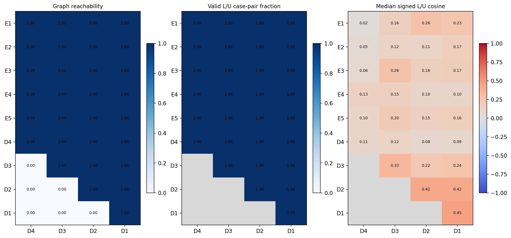
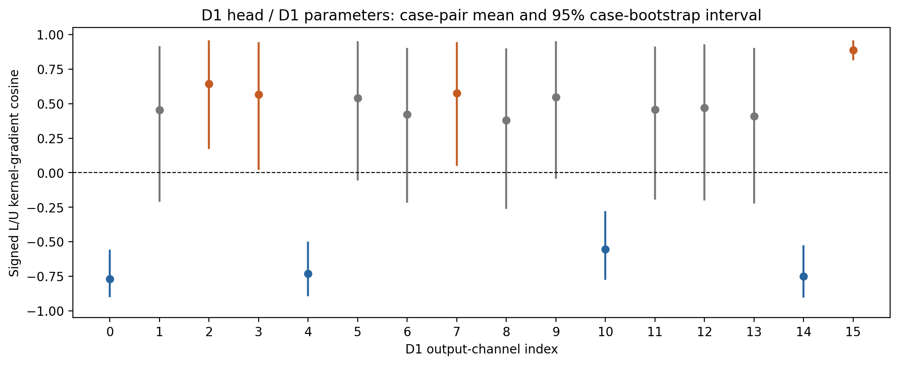

# 阶段 1A 结论与研究判断

本结论仅适用于 LA 10%、iteration 15000 的一组同迭代 Student/Teacher，eval 模式、8 个有标签病例与预选 16 个无标签病例、每病例两个完整裁块。完整数值见 [主报告](runs/la10_iter15000_seed142_fp32/REPORT.md)，不能外推为 train-mode、其他数据集或其他种子的结论。

## 可达性与有效性

九阶段×四损失头共 36 格：30 格可达，6 格结构不可达。不可达的是 D3 参数对 D4 损失，D2 参数对 D4/D3 损失，D1 参数对 D4/D3/D2 损失。这由实际计算图决定，不是该层“没有价值”。

全部可达格在本次样本中均有有效的非零、有限且高于数值阈值的梯度。逐通道表有 2944 行，其中 2768 行有效、176 行标记结构不可达；没有将缺失梯度补零后计算高相似度。病例×通道的展开表与原始梯度保留在独立结果目录。

上述是病例均值和覆盖率层面的结论。逐裁块范数记录还有 **25 个低于阈值的通道观测**，已保留并在相似度计算中屏蔽；不是所有原始裁块观测都有效。详细计数见 output_verification.json。

25 个观测全部来自无标签粗尺度 MT：E5/D4 有 11 个、D4/D4 有 14 个，与这些位置较敏感的方向结果一并报告。不能把它们的近零梯度余弦当作有意义的零分或高分。

## 哪些结构较可重复

- **D1 参数对 D1 损失的病例重复方向最稳定。**同病例不同裁块的 L/U 中位余弦为 0.986/0.999，不同病例为 0.928/0.971。D2 对 D2/D1 损失也较稳定：L 重复为 0.762/0.808，U 重复为 0.889/0.926。
- **E1 的 MT 方向稳定，不代表其监督方向跨病例稳定。**E1/D1 的 U 同病例/跨病例中位余弦为 0.995/0.967，但 L 跨病例仅 0.036；E1/D4 的 L 跨病例甚至为 −0.255。必须按目标与病例层次解释，不能只看一个高相似度指标。
- **E5 和 D4 上采样分支对裁块较敏感。**E5 的 L 同病例重复余弦范围约 0.103–0.188，D4 分支对自身 D4 损失仅 0.066（L）/0.137（U）。这些位置的方向证据不足以支持固定通道分组用于训练。
- 以上是方向稳定性，不是任务优劣或层的重要性排序。不同阶段核向量维度不同，也不能直接用其范数大小比较贡献。

## 多尺度深监督并非所有方向相同

在共享的深层参数上，D2 与 D1 头往往较一致：E5 的跨头余弦中位数为 0.978（L）/0.973（U），D4 上采样分支为 0.969/0.966。

但 D4 粗尺度辅助头与较细头的方向可以明显不同。在 D4 上采样参数上，D4 与 D1 头的中位余弦只有 0.084（L）/0.132（U），且部分通道分布包含负值。**这支持“各监督尺度作用不同”的描述，不能直接解释为互补、协同或边界增强。**

同一病例内多尺度梯度一致，与同一尺度跨病例方向稳定也不是同一件事。例如 D4 参数的 D2/D1 跨头一致性很高，但各自的跨病例监督方向仍较弱。

## 阶段均值会掩盖通道的反向关系

D1/D1 的 L/U 通道中位平均余弦为 0.454，但不是全部通道对齐。病例 bootstrap 的未校正 95% 区间在以下四个通道持续为负：

| 通道（0 起始） | L/U 病例对平均余弦 | 病例 bootstrap 区间 |
| --- | --- | --- |
| 0 | −0.770 | [−0.902, −0.559] |
| 4 | −0.732 | [−0.894, −0.499] |
| 10 | −0.554 | [−0.776, −0.278] |
| 14 | −0.750 | [−0.903, −0.527] |

另有 4 个通道区间在正侧、8 个包含零。这是固定病例样本与当前权重上的梯度方向差异；没有多重比较校正、训练干预或独立样本验证，不能宣称发现了普适“有害通道”，也不据此交换/删除通道。

## PCA 与聚类的客观解释

E4、D4、D3 的 PC1 分别解释约 97.7%、97.4%、98.7% 的范数占比变异，但其实测秩仍达到各自代数上限。这是主方向集中的描述，不能把占比归一化的约束造成的低维结构当作通道协同证据。

E1 的 k=2 bootstrap ARI=1.000，但组大小为 **15∶1**，主要是稳定分出一个离群通道，不是两个已证实的功能通道组。E3、E4、D3 的 ARI 均值分别为 0.927、0.898、0.894，说明当前范数模式有一定分组重复性；E5 只有 0.472，分组明显更不稳定。其他 k 候选及组大小均保留，未挑选最有利结果。

D1 只有一个可达头，跨尺度范数占比恒为 1，PCA 秩为 0。其分组分析在这个设计下 **不可识别**；不能把它解释为所有通道高度协同。

## LossNorm 实际改变了什么

本地原流程对四尺度均值作 LossNorm，而不是各头独立归一化。相对未归一化、未乘任务系数的每头均值贡献 g_s/4，本次监督缩放系数的裁块中位数为 25.01；MT 包含 0.3 权重后的中位数为 268.70。幅值必须结合原始梯度一起解释，不能仅据缩放倍数判定 MT 占主导。

每个裁块的正标量缩放不改变原始有效余弦。但跨裁块平均前归一化会重新加权裁块。例如 E1/D2/通道 8 的病例均值 L/U 余弦从 0.261 变为 0.342，差约 0.082。这不是单个向量缩放改变了方向，而是不同裁块权重变化后的平均方向改变。

原始梯度、g_s/4 以及原 LossNorm 对应贡献的范数都已记录；原公式与梯度重构验证通过，没有改动 LossNorm 本身。

## 这些是否是边界相关梯度

**目前不能这样命名。**这里的目标只有普通区域分割 CE+Dice 与概率 MT MSE，既没有显式轮廓目标，也没有边界定位关联证据。相似度、负方向、低秩和分组都不足以给通道赋予“边界”语义。

下一步更合适的假设检验可以先继续冻结模型，沿用已有分割头，而不是直接训练九个边界头：

1. 只在有真实 GT 的病例上，用 GT 距离场定义窄边界带，并比较预先指定的 1/2/3 个原图体素带宽。HDF5 未提供可靠体素间距时明确使用体素单位。各尺度用面积/体积平均方式传播边界权重，避免 nearest 直接缩小细边界使其消失。
2. 在各已有分割头定义边界带内、前景/背景平衡的 CE，或边界带 soft Dice。它是显式边界聚焦诊断目标；先比较它与区域目标、以及同一有标签图像上 Teacher–Student MSE 对**同一卷积参数**的梯度，不需要无标签 GT 或新预测头。
3. 与等体积、前景/背景比例匹配的随机区域、区域内部和空间平移的边界带比较。如果只是困难体素、幅值或类别比例效应，也应被对照揭示。若后续使用单独轮廓 BCE/Dice 或有符号距离回归头，应另行隔离其参数与新增建模因素。
4. 在预先锁定的独立有标签验证病例、更多裁块、模型迭代及标注种子上复核。LA 原 test.list 已用于在线选模，不能再称为独立验证证据。只有边界特异关联重复成立，才讨论另外的干预/消融是否支持协同或性能因果作用。

以上只是后续实验设计建议，本阶段没有实现这些边界目标、预测头、通道选择或训练。

## 当前解释的限制

仅一个模型迭代、一组标注划分，16/72 个无标签病例，每病例两个裁块；不能证明总体或跨数据集稳定。两个模型使用各自保存的 BN 统计且 eval 禁用 Dropout，MT 梯度也包含其独立 BN 统计差异，不能替代原 train-mode 分析。2768 个通道×尺度覆盖有效并不表示符号稳定或具有边界含义；bootstrap 区间仅为当前病例重采样下的探索性不确定性。
