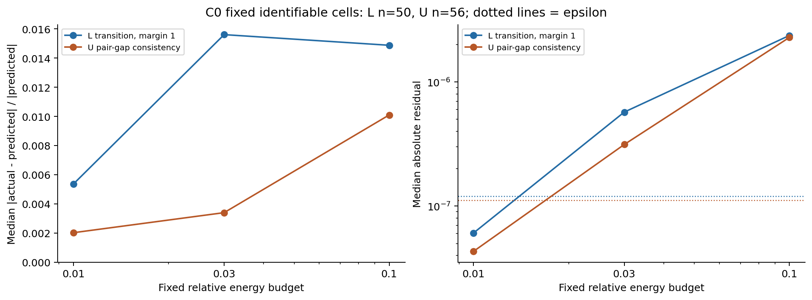

# Stage1C C0：最终 smoke 报告

**C0通过。仅证明几何、节点、干预和局部数值归因可用，不证明可靠边界通道。没有执行C1/C2/C3或正式训练。**

最终运行：`runs/c0_la10_checked/`。预先设计见[DESIGN](DESIGN.md)，测试与失败记录见[TEST_REPORT](TEST_REPORT.md)。

## 起点核查

本地07a0b90f840dbf26776e2f9df9077be47dd90fa3，远程main锁定5f6303a4ffde996a8200c294a47d35062f54e8b6。共有290个文件Git blob全部一致，本地另有22个历史图件；不能称两个完整Git树相同。公开artifact manifest相同，本地Stage1B manifest的210文件SHA全部核实；完工时远程HEAD仍一致。711个历史文件最终SHA全部不变。

## 固定范围与几何

原LA10 iteration15000配对Student/Teacher，eval，FP32网络/反向、TF32 off、FP64损失运算。发现集2L+2U，每病例原有2crop，共8crop。最终运行65.980s，峰值4288.7MiB；未进入probe。所有病例曾参与Baseline训练，不能称独立泛化验证。

| 域 | 病例 | crop | 候选面数 | 采样对数 | 端点M覆盖 | 状态 |
| --- | --- | --- | --- | --- | --- | --- |
| L | 06SR5RBREL16DQ6M8LWS | 0 | 25204 | 2048 | 1.00000 | valid |
| L | 06SR5RBREL16DQ6M8LWS | 1 | 25577 | 2048 | 1.00000 | valid |
| L | 1D7CUD1955YZPGK8XHJX | 0 | 24705 | 2048 | 1.00000 | valid |
| L | 1D7CUD1955YZPGK8XHJX | 1 | 27847 | 2048 | 1.00000 | valid |
| U | 3C2QTUNI0852XV7ZH4Q1 | 0 | 14919 | 2048 | 1.00000 | valid |
| U | 3C2QTUNI0852XV7ZH4Q1 | 1 | 15263 | 2048 | 1.00000 | valid |
| U | 57SGAJMLCTCH92QUA0EE | 0 | 24622 | 2048 | 1.00000 | valid |
| U | 57SGAJMLCTCH92QUA0EE | 1 | 14640 | 2048 | 1.00000 | valid |

L为GT前景/背景6邻接对的softplus排序，主margin1.0，0.5/2.0为固定敏感性；独立参照普通CE和原宽2边界CE。U为Teacher候选位置对的概率差MSE，参照MT和edge_w2。没有将目标相加或独立LossNorm。2048对可共享端点，不是2048个独立样本。真实数据只用最终D1损失，不在粗头强制制造细边界；CPU验证粗尺度坍缩/占有率与逆坐标。

U只验证候选几何/概率关系、同crop整数坐标与stop-gradient，**没有验证Teacher真实边界正确性或增强可靠性**，可靠性状态为not_assessed_in_C0，不能直接用于训练。

## 五阶段同节点合同

| 阶段 | 真实干预模块/位置 | shape | 固定通道 |
| --- | --- | --- | --- |
| E3 | block_three/output | [1, 64, 28, 28, 20] | [0, 32, 63] |
| E4 | block_four/output | [1, 128, 14, 14, 10] | [0, 64, 127] |
| D3 | block_seven/input | [1, 64, 28, 28, 20] | [0, 32, 63] |
| D2 | block_eight/input | [1, 32, 56, 56, 40] | [0, 16, 31] |
| D1 | out_conv/input | [1, 16, 112, 112, 80] | [0, 8, 15] |

40个stage/crop的捕获节点与九阶段接口tensor为同一对象；D3/D2 skip融合等式精确成立。主目标对接口和实际节点的GPU特征梯度逐项相同。D3/D2在融合后下游路径处削弱，辅助头本身loss不参与C0评分；CPU反例覆盖这个区别。特征梯度和反卷积/卷积参数梯度分开保存、分开解释。

## 三剂量一阶近似

360个单通道干预、1440个独立目标差分；全部能量匹配，无alpha超限失败。实际F_before-F_after的L2相对目标最大差3.077e-06，实际向量与公式向量的舍入L2相对预算最大1.250e-05。alpha<=0.5，M/alpha/位置对/Teacher目标均冻结，不对这些选择过程求导。

| 域 | 剂量 | 共同可辨识观测 | median相对残差 | median绝对残差 | median epsilon |
| --- | --- | --- | --- | --- | --- |
| L | 0.01000 | 50 | 0.00536 | 6.079e-08 | 1.200e-07 |
| L | 0.03000 | 50 | 0.01561 | 5.718e-07 | 1.200e-07 |
| L | 0.10000 | 50 | 0.01488 | 2.368e-06 | 1.200e-07 |
| U | 0.01000 | 56 | 0.00202 | 4.324e-08 | 1.112e-07 |
| U | 0.03000 | 56 | 0.00339 | 3.135e-07 | 1.112e-07 |
| U | 0.10000 | 56 | 0.01010 | 2.284e-06 | 1.112e-07 |

共同观测按预设条件：三档有效、最小档abs(Delta_hat)>5epsilon、alpha<=0.05。L 50/60、U 56/60；这是数值可辨识筛选，不是未来通道选择。L在0.03到0.10的相对残差不严格单调，不能宣称每档/每通道都满足理想二阶缩放；两域最小档均比最大档更准确并通过预先门槛。

| 域 | 主目标 | 最小档可判定实际变化数 | 符号准确率 | C0局部门槛 |
| --- | --- | --- | --- | --- |
| L | transition_m1 | 58 | 1.00000 | PASS |
| U | u_transition | 59 | 1.00000 | PASS |

符号准确率只针对超出不确定区间的真实变化，不把不可判定样本算正确。局部预测使用本crop本loss梯度，不能冒称不依赖标签的通道发现，也没有重新排名CHAP通道或证明优于CHAP。

## 预定数值不确定区间

每crop/目标非零干预前有20个null观测；epsilon=max(1e-9,1e-6*max(abs(L0),1e-3),5*最大null差)。区间闭合为[-epsilon,+epsilon]。实测null差约0至1e-16，epsilon主要来自保守精度下限，不应误称观察到同等幅度的随机噪声；门槛从未按消融结果调整。

| 域 | 目标 | 基线loss中位数 | epsilon最小 | epsilon最大 | null最大差 |
| --- | --- | --- | --- | --- | --- |
| L | region_ce | 0.06843 | 6.407e-08 | 7.308e-08 | 1.388e-17 |
| L | boundary_ce_w2 | 0.87961 | 7.740e-07 | 9.308e-07 | 1.110e-16 |
| L | transition_m0_5 | 0.08375 | 6.594e-08 | 1.033e-07 | 1.388e-17 |
| L | transition_m1 | 0.11997 | 9.500e-08 | 1.481e-07 | 2.776e-17 |
| L | transition_m2 | 0.23088 | 1.820e-07 | 2.828e-07 | 2.776e-17 |
| U | mt | 0.00132 | 1.125e-09 | 1.518e-09 | 2.168e-19 |
| U | edge_w2 | 0.01434 | 1.381e-08 | 1.515e-08 | 3.469e-18 |
| U | u_transition | 0.11117 | 9.825e-08 | 1.198e-07 | 0.00000 |

全部1440条有效loss差分：负向926、正向499、方向不可判定15（1.0417%）。没有强制划分正负。真实crop均有有效位置对；空边界/无效通道/近零效应由CPU合同测试和显式状态覆盖。

| 域 | 阶段 | 剂量 | signed rho | 净幅值rho | 符号准确率 | balanced准确率 | 多数方向基线 | 不可判定/有效 |
| --- | --- | --- | --- | --- | --- | --- | --- | --- |
| L | E3 | 0.01000 | 1.00000 | 1.00000 | 1.00000 | 1.00000 | 0.58333 | 0/12 |
| L | E3 | 0.03000 | 1.00000 | 1.00000 | 1.00000 | 1.00000 | 0.58333 | 0/12 |
| L | E3 | 0.10000 | 1.00000 | 1.00000 | 1.00000 | 1.00000 | 0.58333 | 0/12 |
| L | E4 | 0.01000 | 0.99301 | 0.99301 | 1.00000 | 1.00000 | 0.80000 | 2/12 |
| L | E4 | 0.03000 | 0.99301 | 0.99301 | 1.00000 | 1.00000 | 0.81818 | 1/12 |
| L | E4 | 0.10000 | 1.00000 | 1.00000 | 1.00000 | 1.00000 | 0.81818 | 1/12 |
| L | D3 | 0.01000 | 0.99301 | 0.97902 | 1.00000 | 1.00000 | 0.50000 | 0/12 |
| L | D3 | 0.03000 | 0.98601 | 0.95105 | 1.00000 | 1.00000 | 0.50000 | 0/12 |
| L | D3 | 0.10000 | 0.98601 | 0.95105 | 1.00000 | 1.00000 | 0.50000 | 0/12 |
| L | D2 | 0.01000 | 1.00000 | 0.99301 | 1.00000 | 1.00000 | 0.58333 | 0/12 |
| L | D2 | 0.03000 | 0.98601 | 0.97902 | 1.00000 | 1.00000 | 0.58333 | 0/12 |
| L | D2 | 0.10000 | 0.98601 | 0.98601 | 1.00000 | 1.00000 | 0.58333 | 0/12 |
| L | D1 | 0.01000 | 1.00000 | 1.00000 | 1.00000 | NA | 1.00000 | 0/12 |
| L | D1 | 0.03000 | 1.00000 | 1.00000 | 1.00000 | NA | 1.00000 | 0/12 |
| L | D1 | 0.10000 | 1.00000 | 1.00000 | 1.00000 | NA | 1.00000 | 0/12 |
| U | E3 | 0.01000 | 1.00000 | 1.00000 | 1.00000 | 1.00000 | 0.91667 | 0/12 |
| U | E3 | 0.03000 | 1.00000 | 1.00000 | 1.00000 | 1.00000 | 0.91667 | 0/12 |
| U | E3 | 0.10000 | 1.00000 | 1.00000 | 1.00000 | 1.00000 | 0.91667 | 0/12 |
| U | E4 | 0.01000 | 1.00000 | 1.00000 | 1.00000 | 1.00000 | 0.50000 | 0/12 |
| U | E4 | 0.03000 | 1.00000 | 1.00000 | 1.00000 | 1.00000 | 0.50000 | 0/12 |
| U | E4 | 0.10000 | 1.00000 | 1.00000 | 1.00000 | 1.00000 | 0.50000 | 0/12 |
| U | D3 | 0.01000 | 1.00000 | 1.00000 | 1.00000 | 1.00000 | 0.83333 | 0/12 |
| U | D3 | 0.03000 | 0.99301 | 0.99301 | 1.00000 | 1.00000 | 0.83333 | 0/12 |
| U | D3 | 0.10000 | 0.98601 | 0.98601 | 1.00000 | 1.00000 | 0.83333 | 0/12 |
| U | D2 | 0.01000 | 0.99301 | 0.99301 | 1.00000 | 1.00000 | 0.66667 | 0/12 |
| U | D2 | 0.03000 | 0.99301 | 0.99301 | 1.00000 | 1.00000 | 0.66667 | 0/12 |
| U | D2 | 0.10000 | 0.99301 | 0.99301 | 1.00000 | 1.00000 | 0.66667 | 0/12 |
| U | D1 | 0.01000 | 1.00000 | 1.00000 | 1.00000 | NA | 1.00000 | 1/12 |
| U | D1 | 0.03000 | 1.00000 | 1.00000 | 1.00000 | 1.00000 | 0.91667 | 0/12 |
| U | D1 | 0.10000 | 1.00000 | 1.00000 | 1.00000 | 1.00000 | 0.91667 | 0/12 |

所有参照目标和逐点绝对GxA幅值相关性另存fidelity_by_stage_dose.csv；|sum(gFM)|与sum(|gFM|)含义不同，不作替换或翻转符号。rho基于有限数值观测，含方向不可判定者；符号准确率另排除实际不可判定者，门槛另用共同可辨识集。不能由rho推断弱信号有可靠方向或边界语义。

## 最终预测与A/B兼容

每个L干预还计算最终D1整体CE、真实宽2边界CE、hard/soft Dice、1体素容忍轮廓F1、预测改变比例，见intervention_metrics.csv；FP64主CE差与FP32传统指标分开命名。U没有GT，准确性指标明确不可用，只记录预测改变与一致性目标，没有读取U标签。未进行完整体积独立评价。

8crop原A四头loss、原B四头loss均重放；80个原A/B最终头到五阶段参数梯度兼容，最大相对L2差0.000e+00。C0同公式FP64损失与原FP32的舍入差逐项保留，不伪称bitwise一致。

原始主目标feature activation/gradient/M保存40组，独立卷积参数梯度160组，另有8个native pair档案。特征/参数统计各9728行。大型raw数组留在本地独立目录并纳入SHA清单，Git忽略；独立numpy重算360个主目标Delta_hat最大绝对差8.674e-19。

## 解释范围与停止点

C0通过只确认归因实现和局部近似工具可用。没有执行C1的困难度匹配边界专属性、C2的Teacher增强可靠性、C3的通道组或任何正式训练。不能把同目标Taylor准确性叫作可靠边界通道，当前仍无足够证据训练新的边界监督模型。本次到C0停止。
